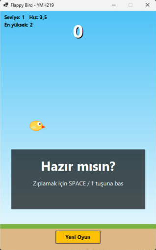
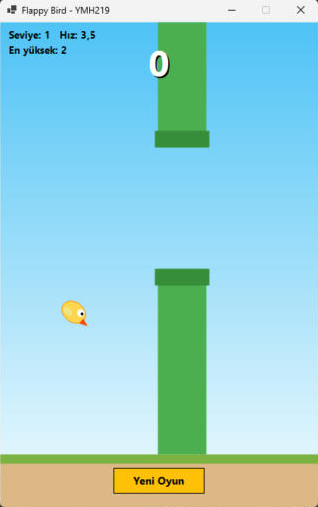
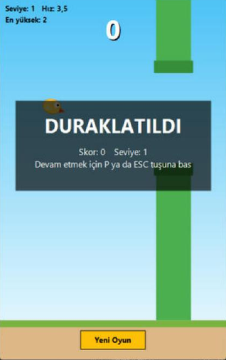
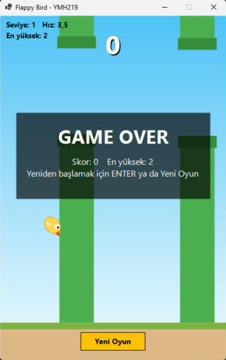
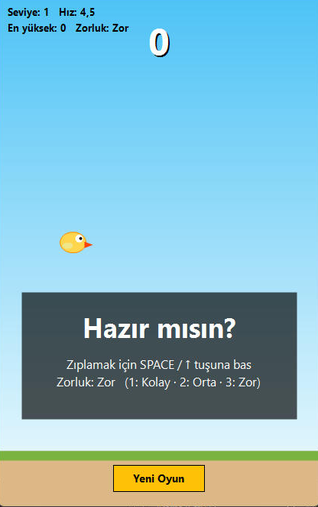

# Flappy Bird — YMH219

Windows Forms ile geliştirilmiş, Flappy Bird benzeri basit bir masaüstü oyunu. Kuş klavyeyle zıplar, yer çekimiyle aşağı düşer; sağdan sola gelen boruların arasındaki boşluktan geçtikçe skor artar. Boruya, zemine ya da tavana çarpınca oyun biter.

Bu proje **Nesne Tabanlı Programlama (YMH 219)** dersi ek uygulama ödevi kapsamında hazırlanmıştır.

**Öğrenci:** Yusuf Aslan — **Numara:** 250541068

## Ekran Görüntüleri

| Başlangıç | Oyun sırasında | Duraklatıldı | Oyun bitti | Zorluk: Zor |
|---|---|---|---|---|
|  |  |  |  |  |

## Kullanılan Teknolojiler

- C# / .NET 10 (`net10.0-windows`)
- Windows Forms (Form, Timer, Button, `OnPaint` ile GDI+ çizim)
- Harici NuGet paketi kullanılmamıştır.

## Kurulum ve Çalıştırma

1. Depoyu indirin:
   ```bash
   git clone https://github.com/JuseufLeo/YMH219-FlappyBird.git
   ```
2. `YMH219-FlappyBird.slnx` dosyasını **Visual Studio 2026** ile açın (.NET 10 SDK ve ".NET masaüstü geliştirme" iş yükü gerekir).
3. Üstteki yeşil **▶ FlappyBird** düğmesine basın (veya `F5`).

Komut satırından çalıştırmak için:
```bash
dotnet run --project FlappyBird
```

## Kontroller

| Tuş | İşlev |
|---|---|
| `Space` / `↑` / `W` | Zıpla (ilk basışta oyun başlar) |
| `P` / `Esc` | Oyunu duraklat / devam ettir |
| `1` / `2` / `3` | Zorluk: Kolay / Orta / Zor (oyun başlamadan önce veya bittikten sonra) |
| `Enter` / `R` | Oyun bittiyse yeniden başlat |
| **Yeni Oyun** butonu | Oyunu istediğiniz an baştan başlatır |

## Özellikler

- Yer çekimi ve zıplama fiziği (hız + ivme)
- Ekranda aynı anda birden fazla engel; ekrandan çıkan engel rastgele yükseklikle yeniden sağa konumlanır
- Boru, zemin ve tavan için çarpışma kontrolü, **Game Over** ekranı
- Her geçilen engelde skor artışı
- **Seviye sistemi:** her 5 puanda bir seviye atlanır ve oyun hızlanır
- **En yüksek skor** `highscore.txt` dosyasında saklanır, oyun kapatılsa da kaybolmaz
- Ekranda seviye, hız, skor ve en yüksek skor bilgisi
- **Zorluk seçimi:** Kolay / Orta / Zor; her zorluğun başlangıç hızı, seviye başına hız artışı ve borular arasındaki boşluğu farklıdır. Her zorluğun en yüksek skoru ayrı tutulur

  | Zorluk | Başlangıç hızı | Seviye başına artış | Boşluk |
  |---|---|---|---|
  | Kolay | 2,8 | 0,3 | 190 px |
  | Orta | 3,5 | 0,5 | 160 px |
  | Zor | 4,5 | 0,6 | 130 px |

- **Duraklatma:** `P` / `Esc` ile oyun durur; pencere arka plana geçince oyun otomatik duraklar

## Proje Yapısı (Sınıflar)

| Dosya | Görevi |
|---|---|
| `Bird.cs` | Kuşun konumu, hızı, yer çekimi ve zıplama hareketi |
| `PipePair.cs` | Üst-alt boru çifti: hareket, ekrandan çıkma ve çarpışma kontrolü |
| `Difficulty.cs` | Zorluk seviyeleri (Kolay/Orta/Zor) ve her birinin hız, boşluk ve rekor dosyası ayarları |
| `GameState.cs` | Oyun durumları: `Ready`, `Playing`, `Paused`, `GameOver` |
| `Game.cs` | Oyun kuralları: döngü adımı, skor, seviye/hız, çarpışma, yeniden başlatma |
| `HighScoreStore.cs` | En yüksek skoru dosyaya yazma ve dosyadan okuma |
| `MainForm.cs` | Klavye ve Timer olaylarını `Game` sınıfına iletir, oyunu çizer |

Form yalnızca olayları yakalar ve çizim yapar; oyunun tüm kuralları `Game` sınıfındadır. Böylece oyun mantığı arayüzden ayrılmış olur.

## Bilinen Sınırlamalar / Geliştirme Notları

- Ses efekti yoktur.
- Grafikler resim dosyası yerine basit şekillerle (elips, dikdörtgen) çizilmektedir.
- Pencere boyutu sabittir (420 × 640).
- İleride eklenebilecekler: ses efektleri.
